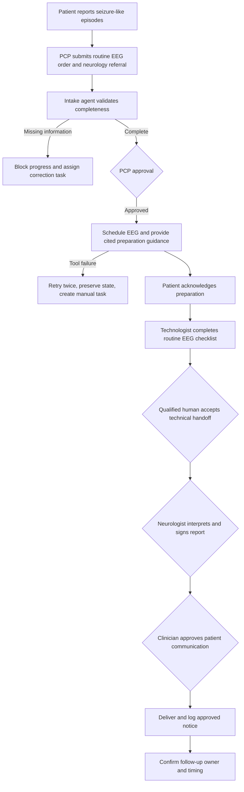

# NeuroFlow Connect — IBM Bob Repository Guide

**Project owner:** Terry Gomez  
**Program:** IBM SkillsBuild AI Experiential Learning Lab / watsonx Challenge  
**Current milestone:** Week 5 end-to-end MVP core flow  
**Build:** NeuroFlow Connect v0.2.0

## Purpose

Use this file as IBM Bob's starting context for exploring, testing, troubleshooting, and improving NeuroFlow Connect.

NeuroFlow Connect is a human-supervised care-coordination prototype for the routine EEG referral-to-follow-up journey. It does **not** diagnose epilepsy, interpret EEG waveforms, recommend treatment, or replace qualified clinicians. Its job is to keep every handoff visible, owned, evidence-grounded, and auditable.

## What has been completed

| Program stage | Completed work | Repository evidence |
|---|---|---|
| Week 1 — Frame | Defined the patient and care-team problem, current journey, pain points, constraints, and assumptions | `docs/MID_PROGRAM_CHECKPOINT.md` |
| Week 2 — Converge | Selected NeuroFlow Connect, its persona, POV, How Might We question, and improved journey | `docs/MID_PROGRAM_CHECKPOINT.md` |
| Week 3 — Value | Wrote the preliminary idea, value proposition, AI-use justification, and IBM Bob role | `docs/MID_PROGRAM_CHECKPOINT.md` |
| Week 4 — Architecture | Defined bounded agent roles, approved knowledge, human gates, orchestration, and failure paths | `docs/ARCHITECTURE.md` |
| Week 5 — Working MVP | Built one complete synthetic referral-to-follow-up flow with tests, citations, approvals, fallbacks, and audit events | `docs/WEEK_5_MVP_CORE_FLOW.md` |

## End-to-end workflow



The authoritative orchestration pattern is:

`input → validation → retrieval → bounded reasoning → policy check → human approval → action → audit`

## Agent responsibilities

| Role | Knows | May decide or do | Must escalate |
|---|---|---|---|
| Supervisor | Current case state, allowed actions, owner, and policy | Select the next eligible bounded action and route work | No eligible action, policy conflict, emergency language, or unauthorized request |
| Intake and Referral | Required referral fields and attachments | Detect missing items and create correction tasks | Order validity or clinical urgency |
| Knowledge and Preparation | Approved, versioned demonstration SOP passages | Retrieve passages, cite sources, and draft bounded guidance | Missing, outdated, or conflicting evidence |
| Scheduling and Readiness | Approved case state, slot availability, and preparation status | Attempt scheduling and track acknowledgment | Tool failure after two retries or unmet readiness conditions |
| EEG Operations and Handoff | Checklist and packet status | Assemble the technical handoff packet | Technical-quality acceptance or incomplete study packet |
| Results and Follow-Up | Signed-report status and approved communication state | Deliver approved language and confirm ownership | Interpretation, diagnosis, treatment, unsigned report, or unapproved communication |

## Human-review gates

Automation must stop for an authorized human at these points:

1. PCP confirmation of order and referral validity.
2. Technologist acceptance of the completed routine EEG checklist.
3. Qualified human acceptance of the technical handoff.
4. Neurologist interpretation and report signature.
5. Clinician approval of patient-facing results communication.
6. Confirmation of the follow-up owner and timing.

Every approval, rejection, override, and reason must be recorded in the audit timeline.

## Safe failure handling

| Condition | Required behavior |
|---|---|
| Missing referral information | Stop scheduling, name the missing fields, and assign a correction task |
| Scheduling service failure | Retry no more than twice, preserve the last safe state, and create a manual task |
| Conflicting approved sources | Display both citations, abstain, and route the conflict to the source owner |
| Clinical or diagnostic request | Refuse interpretation and route the request to a qualified clinician |
| Emergency-language signal | Pause automation and present the approved human-escalation path |
| Unauthorized role | Reject the action without changing state and record the attempt |

## Current proof

- Three fictional cases cover the happy path, missing information, and conflicting evidence.
- Twelve automated tests pass with zero failures and zero errors.
- The app runs locally using Python 3.11 or newer without third-party dependencies.
- The happy path reaches `FOLLOW_UP_CONFIRMED` only after all required human approvals.
- The interface exposes the current state, owner, next action, citations, tasks, and audit timeline.
- Synthetic data is used throughout; production PHI handling is not implemented.

These results prove software behavior only. They do not prove clinical safety, usability, time savings, or patient outcomes.

## IBM technology status

| Technology | Status | Role |
|---|---|---|
| IBM Bob | **Confirmed** | Development partner for code explanation, planning, debugging, tests, feature work, and documentation |
| watsonx.ai with IBM Granite | **Optional until configured and verified** | Evidence-grounded language drafts through `neuroflow/watsonx_adapter.py` |
| watsonx Orchestrate | **Proposed until access and deployment are verified** | Tool routing, approvals, and traces through `openapi.yaml` |
| Local Python supervisor | **Working fallback** | Enforces the same state, role, approval, failure, and audit contracts offline |

Do not describe Granite or watsonx Orchestrate as live unless the configured environment has been tested and the application reports the verified mode.

## How IBM Bob should begin

### 1. Explore

Paste this prompt into IBM Bob:

> Act as a senior Python engineer joining the NeuroFlow Connect project. Read `IBM_BOB_PROJECT_GUIDE.md`, `README.md`, `docs/ARCHITECTURE.md`, and `SECURITY.md`. Then trace one happy-path case from `RECEIVED` to `FOLLOW_UP_CONFIRMED`. Identify the files and functions responsible for state transitions, role permissions, retrieval, safety boundaries, retries, human approvals, and audit logging. Do not change code yet. Return a concise architecture map, three risks, and the commands needed to run the application and tests.

### 2. Verify the baseline

Ask Bob to run:

```bash
python -m unittest discover -s tests -v
python run.py
```

Expected automated baseline: **12 tests run; 12 passed; 0 failures; 0 errors.** Stop and investigate if the baseline differs.

### 3. Fix one reproducible issue

Use this Bob prompt after a specific issue is reproduced:

> Reproduce the reported issue first and add a failing regression test. Explain the root cause and identify the smallest safe correction. Preserve clinical boundaries, role checks, human approval gates, audit minimization, and the last safe workflow state. Apply the fix, run the complete test suite, and summarize the changed files and evidence. Do not weaken or delete a test merely to make the suite pass.

Record the issue, before/after behavior, changed files, Bob's contribution, and test output in version control. Do not claim a fix until the failing test passes and the full suite remains green.

### 4. Build one useful feature

Recommended feature for the recorded Bob build task: **a human-readable handoff summary that shows the current owner, completed approvals, unresolved tasks, cited preparation sources, and the next safe action without exposing clinical interpretation.**

Acceptance criteria:

- Uses only already-authorized case fields.
- Contains no EEG interpretation, diagnosis, or treatment recommendation.
- Clearly separates completed steps from pending human decisions.
- Shows source IDs when preparation guidance is included.
- Preserves role permissions and writes no sensitive narrative into audit metadata.
- Includes unit or API tests and a short documentation update.

Suggested Bob prompt:

> Plan and implement the handoff-summary feature described in `IBM_BOB_PROJECT_GUIDE.md`. First identify the smallest set of files to change and propose acceptance tests. Wait for confirmation before editing. After approval, implement the feature, run the entire test suite, and update the relevant documentation. Keep all clinical decisions human-controlled.

## Run locally

```bash
cd neuroflow-connect-mvp
python run.py
```

Open <http://127.0.0.1:8000>.

Run verification separately:

```bash
python -m unittest discover -s tests -v
```

## Evidence to retain for the IBM Bob submission

- Bob's initial architecture explanation.
- Screenshot or transcript of the reproduced issue.
- Failing regression test before the fix.
- Bob's root-cause explanation and proposed plan.
- Commit showing the smallest safe correction.
- Full passing test output after the fix.
- Before-and-after view of the useful feature.
- Commit history or pull request identifying Bob-assisted work.
- Final demo showing a human gate, safe failure, and complete follow-up closure.

## Next validation step

During Weeks 6–8, test the same workflow with five representative users. Measure the same task before and after NeuroFlow Connect, record failures and design changes, and carry only measured evidence into the final pitch.

## Guardrail

This prototype uses synthetic data and is decision support for workflow coordination only. It is not a medical device, diagnostic system, emergency service, production EHR integration, or substitute for professional clinical judgment.
