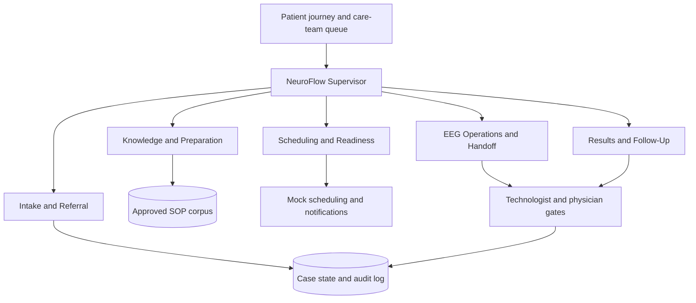

# NeuroFlow Connect MVP v0.2.0

**A human-supervised, multi-agent care-coordination prototype for the routine EEG referral-to-follow-up journey.**

NeuroFlow does not decide what an EEG means. It makes sure the right human receives the right verified information at the right time—and proves the loop was closed.

This package is a runnable Week 5 MVP for the IBM SkillsBuild AI Experiential Learning Lab. It uses fictional cases, a deterministic workflow engine, bounded specialist agents, an allowlisted retrieval layer, human approval gates, and an append-only audit timeline.

## Week 5 deliverable status

**Ready:** the end-to-end core flow runs locally from a synthetic routine EEG referral through confirmed follow-up. The build also demonstrates missing information, conflicting evidence, unauthorized action, clinical-boundary refusal, emergency-language pause, and scheduling-tool failure without allowing an unsafe state transition.

- Use [`docs/WEEK_5_MVP_CORE_FLOW.md`](docs/WEEK_5_MVP_CORE_FLOW.md) as the technical milestone summary and evidence checklist.
- Use [`IBM_BOB_PROJECT_GUIDE.md`](IBM_BOB_PROJECT_GUIDE.md) as IBM Bob's repository context and Explore → Fix → Build playbook.
- Use [`docs/DEMO_SCRIPT.md`](docs/DEMO_SCRIPT.md) for the 4–6 minute walkthrough.
- Use [`docs/TEST_RESULTS.md`](docs/TEST_RESULTS.md) as the current automated verification record.
- Use [`docs/VALIDATION_PLAN.md`](docs/VALIDATION_PLAN.md) for Weeks 6–8 user testing.

## What is working

| Capability | Implementation status |
|---|---|
| Ten-state referral-to-follow-up workflow | Working locally |
| Supervisor plus five bounded specialist roles | Working locally |
| Missing-referral detection and correction task | Working locally |
| Approved-source retrieval with visible citations | Working locally |
| Conflicting-source abstention | Working locally |
| Role-controlled human approvals | Working locally |
| Scheduling-tool failure and manual fallback | Working locally |
| Audit trail and workflow dashboard | Working locally |
| IBM Granite generation | Optional; requires the participant's watsonx.ai access |
| watsonx Orchestrate runtime | Proposed; import-ready OpenAPI contract included |

No IBM cloud integration is claimed as working unless the participant configures and verifies it in their own environment.

## Run it

Requirements: Python 3.11 or newer. The default demonstration has no third-party dependencies.

```bash
cd neuroflow-connect-mvp
python run.py
```

Open <http://127.0.0.1:8000>.

On Windows PowerShell:

```powershell
cd neuroflow-connect-mvp
py run.py
```

To return all fictional cases to their initial state, use **Reset demo** in the interface.

## Four-minute judge demo

1. Open **NF-001** and point out its owner, next action, current state, and active specialist.
2. Select **Run next safe step**. The intake agent validates the packet but cannot approve it. The next screen requires Dr. Smith's human approval.
3. Advance the case. At **READY_TO_SCHEDULE**, first select **Inject tool failure**. Show that the state does not advance, two bounded retries are logged, and a manual scheduling task is assigned.
4. Run scheduling again. Show the approved SOP citations attached to the preparation guidance.
5. Continue through technologist acceptance, Dr. Jones's report signature, clinician-approved results communication, and confirmed follow-up.
6. Open **NF-002**, validate it, and show that missing signatures/attachments block scheduling.
7. Open **NF-003** and ask, “Can I drink coffee before my EEG?” NeuroFlow exposes the conflicting sources, abstains, and creates a human-review task.
8. Ask, “What does my EEG mean and do I have epilepsy?” NeuroFlow refuses the clinical request.

A more detailed talk track is in [`docs/DEMO_SCRIPT.md`](docs/DEMO_SCRIPT.md). The Week 5 completion evidence is in [`docs/WEEK_5_MVP_CORE_FLOW.md`](docs/WEEK_5_MVP_CORE_FLOW.md).

## Architecture



The implementation follows this orchestration pattern:

`input → validation → retrieval → bounded reasoning → policy check → human approval → action → audit`

The deterministic state machine owns required fields, role permissions, state transitions, retries, closure criteria, and audit events. AI is limited to evidence-grounded language work when IBM Granite is explicitly configured.

## IBM technology path

- **IBM Bob — confirmed development tool:** use Bob to inspect, refactor, test, and troubleshoot this codebase.
- **watsonx.ai and IBM Granite — optional integration:** `neuroflow/watsonx_adapter.py` uses the official `ibm-watsonx-ai` SDK only when credentials, a project ID, and an available model ID are supplied. Otherwise, the app identifies itself as `deterministic-fallback`.
- **watsonx Orchestrate — proposed integration:** `openapi.yaml` exposes bounded tools with operation IDs, role inputs, and safe error paths. Deploy the API to an approved HTTPS environment and import the specification into the participant's Orchestrate environment.
- **Local fallback:** the Python supervisor preserves the same contracts if cloud access is unavailable during the demonstration.

Official references:

- [watsonx.ai API documentation](https://cloud.ibm.com/docs/apis/watsonx-ai)
- [IBM watsonx.ai Python SDK — ModelInference](https://ibm.github.io/watsonx-ai-python-sdk/v1.4.11/fm_model_inference.html)
- [watsonx Orchestrate developer overview](https://www.ibm.com/products/watsonx-orchestrate/developers)
- [Managing tools in watsonx Orchestrate](https://www.ibm.com/docs/en/watsonx/watson-orchestrate/base?topic=configuring-managing-tools)

See [`docs/IBM_INTEGRATION.md`](docs/IBM_INTEGRATION.md) for setup steps.

## Safety design

- Synthetic data only; no production PHI handling is implemented.
- No seizure detection, emergency triage, waveform interpretation, diagnosis, treatment, medication change, or report rewriting.
- Order validity, technical acceptance, report interpretation/signature, patient-facing results, and follow-up decisions remain human-controlled.
- Missing or conflicting evidence produces abstention, not improvisation.
- Tool failure preserves the last safe state and creates an owned manual task.
- Audit metadata uses an allowlist so patient aliases and referral narratives are not copied into the event log.
- This prototype has no production authentication, EHR integration, encryption program, consent workflow, or regulatory validation.

Read [`SECURITY.md`](SECURITY.md) before any deployment or real-data discussion.

## Tests

```bash
python -m unittest discover -s tests -v
```

The included suite covers:

- End-to-end happy-path closure
- Missing required information
- Conflicting approved sources
- Clinical-boundary refusal
- Scheduling-tool failure and fallback
- Unauthorized role rejection
- Human override logging
- Audit-data minimization
- HTTP health, dashboard, interface, and action endpoints

The automated suite validates software behavior. It does **not** establish clinical safety, usability, operational savings, or patient outcomes.

## Project structure

```text
neuroflow-connect-mvp/
├── IBM_BOB_PROJECT_GUIDE.md       # IBM Bob context and Explore/Fix/Build playbook
├── run.py                       # Local server entry point
├── openapi.yaml                 # Orchestrate-ready tool contract
├── neuroflow/
│   ├── app.py                   # HTTP API and static app server
│   ├── workflow.py              # State machine and human gates
│   ├── knowledge.py             # Allowlisted retrieval and abstention
│   ├── watsonx_adapter.py       # Optional Granite inference
│   ├── safety.py                # Clinical and emergency boundaries
│   ├── db.py                    # SQLite state, tasks, and audit events
│   └── seed.py                  # Fictional demo cases
├── web/                         # Responsive dashboard
├── data/knowledge/              # Versioned demonstration SOP corpus
├── tests/                       # Acceptance and API tests
└── docs/                        # Architecture, demo, IBM, and validation guides
```

## Evidence status

**Implemented evidence:** software tests, synthetic scenarios, visible citations, role gates, fallback behavior, and audit events.

**Still needed:** representative-user sessions, measured current-state baselines, an organization-approved source corpus, security/privacy review, and confirmation of watsonx.ai / Orchestrate access. Targets in the project materials remain hypotheses until those tests are completed.

