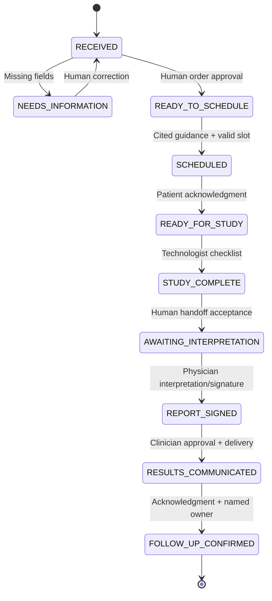

# Architecture and Agent Contracts

## Hero workflow

**Trigger:** A synthetic routine EEG order and neurology referral arrive from Dr. Smith.

**Primary outcome:** The patient reaches a confirmed appointment, completes the study, receives clinician-approved communication after Dr. Jones signs the report, and has a named follow-up owner.

**Completion point:** `FOLLOW_UP_CONFIRMED` is allowed only after delivery, acknowledgment, owner, and timing are recorded.

## Supervisor-and-specialists pattern

| Component | Knows | Decides | Does | Escalates |
|---|---|---|---|---|
| NeuroFlow Supervisor | State, policies, tasks, approvals, tool health | Next eligible bounded step | Routes work and enforces transitions | Conflicting state, timeout, tool/policy failure |
| Intake & Referral | Required administrative schema and supplied packet | Complete vs. needs information | Extracts/checks fields and creates correction tasks | Urgency language, identity/order conflict, missing authorization |
| Knowledge & Preparation | Allowlisted, versioned SOP corpus | Evidence sufficient, absent, or conflicting | Retrieves passages, attaches citations, drafts guidance | Missing/stale/conflicting sources or clinical questions |
| Scheduling & Readiness | Readiness, mock slots, preferences, reminders | Which valid mock slot to offer | Records selection and readiness acknowledgment | No slot, tool failure, non-response, accessibility needs |
| EEG Operations & Handoff | Completion event and checklist | Packet present for human acceptance | Creates/routs a technical-review task | Possible artifact, missing files, safety event |
| Results & Follow-Up | Signature status, communication approval, delivery and follow-up | Administrative prerequisites satisfied | Routes approved notice and tracks closure evidence | Unsigned report, failed delivery, patient question, overdue follow-up |

## State model

The state never advances silently on a tool failure. `PAUSED` and `QUARANTINED` are workflow-status controls layered over the last safe clinical-journey state.

## Human gates

| Gate | Authorized human | Required before |
|---|---|---|
| Clinical urgency / emergency response | PCP, neurologist, or emergency clinician | Any further automation when acute-risk language appears |
| Order and referral validity | PCP or authorized referral clinician | `READY_TO_SCHEDULE` |
| Procedure and technical acceptance | Qualified EEG technologist / neurologist | `AWAITING_INTERPRETATION` |
| EEG interpretation and report signature | Qualified physician | `REPORT_SIGNED` |
| Patient-facing results and follow-up plan | Authorized clinician | `RESULTS_COMMUNICATED` |
| Workflow override | Authorized administrator, neurologist, or compliance lead | Any exceptional state change |

## Failure behavior

| Failure | Safe response | State behavior |
|---|---|---|
| Missing referral information | Exact correction task | Move to `NEEDS_INFORMATION` |
| Conflicting knowledge sources | Cite, abstain, create SOP review | Preserve current state |
| Scheduling tool unavailable | Two bounded retries, manual task | Preserve `READY_TO_SCHEDULE` |
| Unauthorized role | Reject with 403 | Preserve current state |
| Unsigned report | Reject results release | Preserve `AWAITING_INTERPRETATION` |
| Clinical/diagnostic request | Refuse and route to clinician | Preserve current state |
| Emergency language | Stop automation and create immediate human task | Mark workflow `PAUSED` |

## Data and trust boundaries

- Cases and SOPs are fictional demonstration data.
- SQLite stores local case state, tasks, and audit events.
- Audit event metadata is allowlisted and excludes case narrative/aliases.
- The live Granite adapter is disabled unless all four watsonx environment variables and the IBM SDK are present.
- Model output never controls state directly; deterministic code validates every transition.
- Production identity, access control, encryption, EHR integration, consent, retention, and monitoring are out of scope and must precede real-data use.

